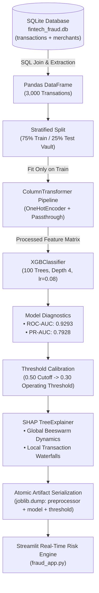
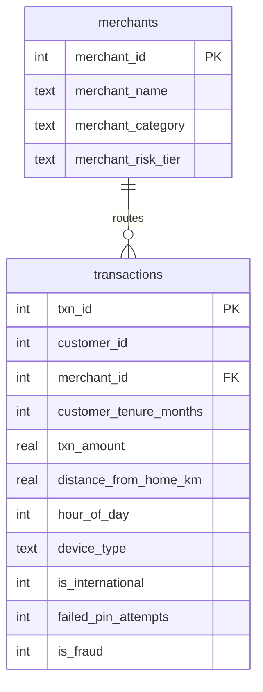

# 🛡️ Real-Time Fintech Fraud Detection & Risk Scoring Engine
### Production Transaction Scoring with SQLite, Cost-Sensitive XGBoost, SHAP Explainability & Streamlit Serving

[](https://www.python.org/)
[](https://xgboost.readthedocs.io/)
[](https://shap.readthedocs.io/)
[](https://streamlit.io/)
[]()

---

## 📌 Executive Architecture & Problem Framing

In digital payment platforms, merchant POS terminals, and transaction switching networks, transaction fraud detection is fundamentally an **asymmetric cost problem**:

* **False Negatives (Missed Fraud):** Direct financial loss from unauthorized debits, cardholder dispute chargeback fines, card scheme penalties, and loss of merchant trust.
* **False Positives (False Alarms):** Legitimate customer transactions declined at the checkout counter, creating severe user friction, abandoned carts, lost merchant interchange fees, and manual review bottlenecks.

Standard classification accuracy is a deceptive vanity metric under extreme class imbalance (e.g. 1% to 15% fraud base rates): a naive classifier predicting all clean (`0`) achieves 85% to 99% accuracy while catching zero fraudulent transactions.

This project delivers an end-to-end, production-grade fraud risk engine:
1. **Relational Database Extraction:** Joining transaction event logs with merchant risk tiers in SQLite (`fintech_fraud.db`).
2. **Leak-Free Preprocessing:** Isolated `ColumnTransformer` with stratified partitioning to protect the test vault.
3. **Gradient Boosted Decision Trees:** High-efficiency `XGBClassifier` optimized for tabular telemetry.
4. **Precision-Recall Threshold Tuning:** Calibrating decision boundaries (0.30 vs 0.50) to optimize the operational cost trade-off.
5. **Explainable AI (SHAP):** Cooperative game-theoretic Shapley attribution for regulatory compliance (CBN/NDPR/GDPR) and local dispute forensics.
6. **Production Serving:** Sub-millisecond pipeline bundle serialization (`joblib`) and an interactive Streamlit risk engine (`fraud_app.py`).

---

## 🏗️ System Architecture Flow



---

## 🗄️ Database Schema & Feature Matrix

The relational database (`fintech_fraud.db`) contains two tables normalized on `merchant_id`:



### Telemetry Signals Used for Real-Time Inference:
* `customer_tenure_months` (int): Number of months the account has been active (mule / burner account indicator).
* `txn_amount` (float): Transaction value in USD.
* `distance_from_home_km` (float): Geographic deviation from customer's primary registered billing coordinate.
* `hour_of_day` (int): Transaction timestamp hour (0-23) for nocturnal spending detection.
* `is_international` (binary): Cross-border card transaction indicator.
* `failed_pin_attempts` (int): Consecutive failed PIN entries at the terminal (brute-force indicator).
* `device_type` (categorical): Channel originating the authorization request (`Android`, `iOS`, `Web`).

---

## 📊 Model Evaluation & Quantitative Scorecard

Evaluation was performed against an unseen test vault of 750 stratified transactions (638 legitimate, 112 fraudulent).

### Discrimination Metrics:
* **Test Set ROC-AUC:** `0.9293`
* **Test Set PR-AUC (Average Precision):** `0.7928`

### Financial Cost Matrix & Operational Threshold Optimization:

In financial fraud operations, operating thresholds are never set arbitrarily. They are governed by an asymmetric **Financial Cost Matrix**:
* **Cost of False Negative (`C_FN` - Missed Fraud):** Stolen transaction balance (sample mean `$790`) + card scheme dispute / chargeback processing fees (`$50`) = **`$840` per missed fraud**.
* **Cost of False Positive (`C_FP` - False Decline):** Operations desk review labor (`$25`) + lost merchant interchange revenue (`$15`) = **`$40` per false alarm**.
* **Asymmetry Ratio:** Missing fraud is **21 times more expensive** than a false decline (`$840` / `$40` = 21:1).

$$\text{Total Operational Loss} = (FN \times 840) + (FP \times 40)$$

| Operational Metric | Default Threshold (0.50) | Calibrated Operating Threshold (0.30) | Operational & Financial Impact |
| :--- | :---: | :---: | :--- |
| **True Positives (Caught Fraud)** | 62 | **70** | **+12.9% more fraudulent transactions intercepted** |
| **False Negatives (Missed Fraud)** | 50 | **42** | **16% reduction in unrecovered fraud chargebacks** |
| **Fraud Recall Rate** | 55.4% | **62.5%** | Substantially higher fraud capture coverage |
| **Fraud Precision** | 89.9% | **76.9%** | Controlled false alarm rate for operations |
| **True Negatives** | 631 | 617 | Minimal impact on legitimate customer approvals |
| **False Positives** | 7 | 21 | Merchant friction strictly bounded at 3.3% of clean txns |
| **F1-Score (Fraud Class)** | 0.6851 | **0.6897** | Superior balance between recall and precision |
| **Total Operational Loss (USD)** | **`$42,280`** | **`$36,120`** | **`$6,160` Net Savings (14.6% Dollar Loss Reduction)** |

> **Financial Decision Rationale:** Tuning the threshold from `0.50` to `0.30` intercepts 8 additional fraudulent transactions, cutting direct chargeback loss from `$42,000` to `$35,280`. While false alarms add `$560` in review labor, the net financial savings is **`$6,160` across 750 transactions**, while keeping 96.7% of clean transactions approved instantly without friction. Lowering below 0.25 is rejected because customer friction and support review costs escalate rapidly.

---

## 🔍 Explainable AI (SHAP) & Forensic Governance

In modern fintech operations, black-box predictions violate regulatory mandates (NDPR, CBN consumer protection guidelines, GDPR Article 22). When a transaction is blocked at a POS terminal or gateway, investigators need to know the exact factors that triggered the alert.

Instead of relying on opaque split counts, SHAP calculates the exact marginal contribution of each feature to the model's prediction by measuring how the predicted fraud probability changes when that feature is included versus excluded across all possible feature combinations.

Using `shap.TreeExplainer`, we audit both the global risk mechanics and local forensic profiles:

### 1. Global Risk Drivers (SHAP Directional Beeswarm)
* **`failed_pin_attempts`:** The strongest single positive risk driver. High values (3-5 failed entries) push model log-odds aggressively toward fraud.
* **`customer_tenure_months`:** The strongest protective feature. Long account tenure (seasoned accounts) exerts strong negative SHAP attribution, protecting legitimate power users from false declines.
* **`txn_amount` & `distance_from_home_km`:** Exhibit non-linear compounding: high transaction amounts at high distances from the home coordinate exponentially amplify risk log-odds.

### 2. Local Transaction Forensics (Waterfall Audits)
* **Flagged Fraud Transaction (#high_risk):** A high-value transaction with 3 failed PIN attempts and cross-border routing was flagged with a **99.3% fraud probability**. The SHAP waterfall provides compliance officers with exact additive evidence (+0.82 from failed PINs, +0.65 from transaction amount).
* **Approved Clean Transaction (#low_risk):** A daytime transaction with 0 failed PINs and 36 months of account tenure scored a **0.08% fraud probability**, with tenure contributing -1.24 in negative attribution.

---

## 💻 Interactive Streamlit Application (`fraud_app.py`)

The production risk engine is deployed via an interactive Streamlit application that evaluates incoming transaction payloads and generates dynamic SHAP waterfall forensics in real time.

```bash
# Launch the risk engine
streamlit run fraud_app.py
```

### Application Features:
* **Interactive Telemetry Sliders:** Adjust transaction amount, geo-distance, failed PIN entries, device type, hour of day, and cross-border status.
* **Real-Time Probability Meter:** Displays instant model risk percentage against the `0.30` operational threshold.
* **Automated Decision Routing:** Renders `✅ TRANSACTION APPROVED` or `🚨 FLAGGED FOR REVIEW`.
* **Dynamic SHAP Forensic Waterfall:** Automatically renders the exact additive breakdown explaining why that specific transaction was flagged or cleared.

---

## 🚀 Quickstart & Reproducibility

### 1. Clone the Repository
```bash
git clone https://github.com/Neabem/credit-card-fraud-detection.git
cd credit-card-fraud-detection
```

### 2. Create and Activate Virtual Environment
```bash
python3 -m venv venv
source venv/bin/activate  # On Windows: venv\Scripts\activate
```

### 3. Install Dependencies
```bash
pip install -r requirements.txt
```

### 4. Run the Executed Notebook
Open [`Fintech_Fraud_Detection.ipynb`](Fintech_Fraud_Detection.ipynb) in JupyterLab or VS Code to inspect the full end-to-end execution, database queries, and rendered SHAP visualizations.

### 5. Launch the Web App
```bash
streamlit run fraud_app.py
```

---

## 📁 Repository Structure

```
credit-card-fraud-detection/
├── Fintech_Fraud_Detection.ipynb      # Complete 9-part production notebook (fully executed)
├── fraud_app.py                       # Real-time Streamlit risk engine & SHAP dashboard
├── fintech_fraud.db                   # Relational SQLite database (transactions + merchants)
├── fraud_detection_pipeline.joblib    # Serialized production pipeline (model + preprocessor)
├── requirements.txt                   # Environment dependencies
├── .gitignore                         # Build and cache exclusions
└── README.md                          # Production engineering documentation
```

---

## 👨‍💻 Author & Engineering Profile

**Omosaiye Nehemiah**  
* B.Tech Mathematics (First Class Honours, CGPA 4.30/5.00), Federal University of Technology Owerri (FUTO)  
* Specialized in Machine Learning Systems, Asymmetric Risk Optimization, and Explainable AI (SHAP)  
* GitHub: [@Neabem](https://github.com/Neabem)
